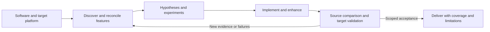

[English]([REA](https://github.com/morluto/rea)DME.md) · [简体中文](README_zh.md) · [日本語](README_ja.md) · [Español](README_es.md) · [Français](README_fr.md) · [Deutsch](README_de.md) · [Português (Brasil)](README_pt-BR.md)

# SRE — Software Resynthesis Engine

[](https://github.com/lovejzzz/SRE/actions/workflows/test.yml)

**Name the software. Choose the platform. Describe what should be better.**

SRE is an agent skill for researching existing software and building a validated successor: preserve behavior, adapt it to a new platform, and add or improve features. The ambition spans games, desktop applications, command-line tools, web and mobile software. Feasibility depends on accessible evidence, dependencies, and the destination platform.

**v0.2 — a skill with executable research and validation tools.** The host agent performs investigation and coding. This is not a guarantee of complete, one-click reconstruction of arbitrary software.

## Quick start

Use a host that supports local skills. Helpers require **Python 3.10+**, with no third-party Python dependencies. REA is optional; the installer does not install REA or analysis engines.

```bash
git clone https://github.com/lovejzzz/SRE.git
python3 SRE/scripts/install.py
```

The installer uses `$CODEX_HOME/skills` or `~/.codex/skills`, refuses to overwrite an existing installation, and supports `--skills-dir /path/to/skills`. Preserve local edits when upgrading. Reload the skill in your host, then ask:

> Use $software-resynthesis to research this desktop application and rebuild it as an offline web app. Preserve the document workflow, add batch operations, and validate the result against the original. Deliver a tested first milestone without losing the full requested scope.

## How it works



| Capability | What is implemented |
| --- | --- |
| Discovery coverage | Multiple evidence surfaces, feature mappings, dependencies, missing-item checks, versioned baselines |
| Research experiments | Competing hypotheses, predicted observations, ranked discriminating experiments, contradiction detection |
| Execution adapters | Explicit command runner, isolated run directory, reset/action/observation/finalize contract, hashes, logs and timeout handling |
| Domain validation | Normalized image errors, semantic file roundtrips, interaction traces, device/workload-specific performance budgets |
| Acceptance | Recomputed evidence plus research audit; stale policies, uncovered items and unresolved blocking questions prevent acceptance |
| Continuity | Project files and checkpoints; no unattended background scheduler |

REA can provide analysis capabilities. SRE connects research to specifications, implementation and acceptance; it does not bundle a REA client or claim measured superiority to REA. Preserve/adapt/extend features have distinct acceptance obligations.

## Try the executable example

```bash
cd SRE
python3 -m unittest discover -s tests -v
python3 examples/posix-path/run.py --workspace work/posix-run-1
```

The example actually runs Python's `posixpath.normpath` and an independent JavaScript implementation on **417 inputs**, using the adapter protocol. It resolves a research question from source observations, compares outputs, and detects an intentionally faulty implementation. Requires Node.js 18+; the output directory must not exist. This is a small cross-language evidence demonstration, not an independent evaluation of autonomous full-application reconstruction.

## Research tools

`skills/software-resynthesis/scripts/sre.py` exposes:

- `init`, `fingerprint`: initialize private project state and pin selected artifacts.
- `seal`, `audit`: freeze reviewed scope/policies and check discovery coverage.
- `plan`: prioritize supplied experiments by their ability to distinguish hypotheses.
- `run-adapter`: execute a reviewed application adapter and retain diagnostics.
- `compare`, `domain-check`: compare traces or evaluate domain-specific artifacts.
- `check`: require both behavioral evidence and a valid research audit.

Run a subcommand with `--help` for arguments. Output files/directories are not overwritten. Exit codes: 0 success, 1 failed comparison/acceptance/run, 2 malformed input or execution error. **Migration from v0.1:** legacy workspaces need real discovery records and a sealed research baseline before `check` can pass.

## What this does not claim

SRE cannot prove that every feature has been discovered, recover inaccessible server implementations, or make every workload feasible on every platform. `milestone` acceptance is not full-product completion. Hypotheses and surveys are collected by the agent; there is no universal crawler. Adapters are application-specific and execute with host permissions, not in a security sandbox. Domain checks consume normalized JSON; PSD parsing, image decoding, GUI operation and device profiling need appropriate adapters. PZ/Photoshop runtime adapters are not included.

Evidence hashes detect stale records, not fabricated experiments. Independent agent evaluations have not been run. Keep proprietary samples, credentials and personal data in private research workspaces; follow upstream licenses when reusing implementation code.

## Documentation and contributions

- [Skill entrypoint](skills/software-resynthesis/SKILL.md)
- [Research and baseline protocol](skills/software-resynthesis/references/research-protocol.md)
- [Adapter contract](skills/software-resynthesis/references/adapters.md)
- [Domain validation policies](skills/software-resynthesis/references/domain-validation.md)
- [PZ inventory research plan](skills/software-resynthesis/references/pz-inventory.md)
- [Behavioral evaluation protocol](evals/behavioral.md)

Contribute reproducible, sanitized failures with versions, inputs, expected/actual behavior and evidence. Preserve regression tests. Translation improvements are welcome; keep capability and limitation statements aligned across languages. Detailed technical protocols currently use English.

Evidence integrity update: target validations and research observations require SHA-256 digests. See [migration and integrity limits](skills/software-resynthesis/references/validation.md#recorded-evidence-integrity) and [change history](CHANGELOG.md).
