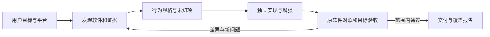

# SRE — Software Resynthesis Engine

**告诉它你想重建哪个软件、运行在哪个平台，以及希望如何改进。由 agent 负责研究、实现和验证。**

SRE 是一个面向 Codex 等支持 skill 的 agent 的工作流包。目标是理解现有软件，将其重建为适合目标平台的后继产品：保留所需行为、适配平台、添加功能、改善体验。游戏、桌面应用、CLI、网页和移动应用都可以成为研究对象；具体可行性取决于可访问证据、依赖和目标平台能力。

当前版本是 **v0.1 skill + 可执行证据工具**。它不是能够保证“任意软件一键完整复刻”的成品服务。研究和编程由宿主 agent 执行，REA 等工具按需接入。

## 安装

需要支持本地 skills 的 agent；辅助脚本需要 Python 3.10+，无第三方 Python 依赖。REA 可选，不会自动安装。

克隆后将 `skills/software-resynthesis` 复制到你的 skills 目录。Codex 的本地安装示例（目录已存在时先检查现有版本，不要覆盖）：

```bash
git clone https://github.com/lovejzzz/SRE.git
python3 SRE/scripts/install.py
```

安装器默认使用 `$CODEX_HOME/skills` 或 `~/.codex/skills`，拒绝覆盖已有安装；可用 `--skills-dir /path/to/skills` 指定其他宿主目录。升级前比较现有版本并保留本地修改。

在宿主重新加载 skill 后调用：

> 使用 $software-resynthesis，研究我已安装的 Project Zomboid 背包系统，做成可在浏览器运行的双人版本。保留物品与容量规则，增加两个手柄的独立操作和共享箱争抢处理。先交付一个经过原游戏对照的最小闭环，再推进剩余功能。

也可以提出完全不同的目标：

> 使用 $software-resynthesis，把这个桌面工具的核心工作流重建为离线移动应用，并加入批量操作。自行查找资料，先验证数据兼容性和平台可行性。

## 工作方式



REA 提供研究能力；SRE 负责把研究转成可追溯的规格、实现和验收。两者互补，不以工具数量或未经测量的“更强”作宣传。SRE 的重点是：

- **保留 / 适配 / 增强分开验收**，不把设计改进当作复刻错误。
- **持久项目状态**，会话中断后能从证据和下一步继续。
- **真实对照与自测分开**，模型编造的轨迹不能当作原软件实测。
- **可复查的差异报告**，记录构建、适配器版本、输入哈希和首个不同位置。
- **有边界的完成判断**，缺失功能、阻塞未知项、失效证据不能被“通过”掩盖。

## 已实现与边界

| 能力 | 当前状态 |
| --- | --- |
| 研究、跨平台实现、功能增强的 agent 指令 | 已提供 |
| REA 工具选择与接入指南 | 已提供，运行时发现工具；未内置 REA 客户端 |
| 初始化 / 文件指纹 / 严格 JSON 轨迹对照 / 验收记录检查 | 可执行，标准库实现 |
| 项目续跑 | 文件协议，由 agent 更新；无后台调度器 |
| PZ 背包验证路线 | 已提供，未完成原游戏 runtime adapter |
| 任意软件自动完成、无人值守、多设备调度 | 未实现，也不保证任意目标可行 |

工具测试不等于真实软件重建评测。测试夹具中的 runtime 标签仅用于验证校验逻辑，不是 PZ 或其他商业软件的运行证据。`check` 是证据记录检查器，不是真实性认证系统；它无法防止操作者伪造整个实验，也不能证明功能发现完整。

## 工具用法

```bash
python3 skills/software-resynthesis/scripts/sre.py init /tmp/sre-example --source "Original app, pinned version" --target "Web"
python3 skills/software-resynthesis/scripts/sre.py fingerprint /path/to/selected/artifact
python3 skills/software-resynthesis/scripts/sre.py compare /tmp/sre-example/runs/source.json /tmp/sre-example/runs/successor.json --out /tmp/sre-example/runs/comparison.json
python3 skills/software-resynthesis/scripts/sre.py check /tmp/sre-example
python3 -m unittest discover -s tests -v
```

初始化目标必须不存在；报告默认不覆盖。退出码：0 成功，1 对照/验收未通过，2 输入或执行错误。轨迹格式、证据规则见 [验证协议](skills/software-resynthesis/references/validation.md) 和 [项目协议](skills/software-resynthesis/references/project-contract.md)。

可复现的[跨语言执行案例](examples/posix-path/README.md)：以运行中的 Python 标准库为参照，对照独立 JavaScript 路径规范化实现，并确认故意引入的错误被检出。该案例验证运行与证据链路，不代表完整软件或 skill 自主能力评测。

原始样本、专有代码、个人存档、密钥和研究日志应留在私有工作区，不提交到此仓库。复用原代码时遵循其许可证；重建行为和复制实现是不同决策。

## 贡献与评测

欢迎提交真实、可复现的失败案例：目标/版本、环境、最小脱敏输入、预期与实际行为、相关证据及运行命令。修复需要保留能够抓住问题的回归测试。不要上传不具备分发权限的软件样本。

优先路线：真实软件端到端案例 → 可复用 runtime adapter → 失败序列最小化 → 多平台构建和设备验证 → 有证据的质量基准。功能覆盖、对照通过率、目标可用性、恢复能力和人工介入次数应分别衡量，不用一个模糊的“复刻率”替代。

目前没有针对 REA 或其他工具的对比评测结论。

[真实任务评测协议](evals/behavioral.md)定义了跨平台重建、增强、缺失依赖、会话恢复和误报防护的评估场景；独立 agent 评测尚未执行。
